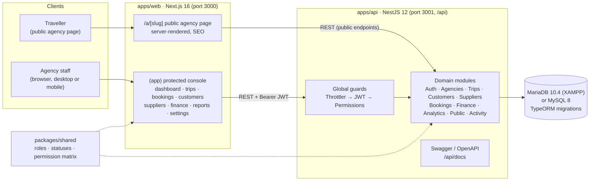

# TravelOS architecture

TravelOS is a **multi-tenant modular monolith**. It has:
- one NestJS REST API,
- one Next.js web app,
- one MariaDB / MySQL database,
- a shared TypeScript package for the domain vocabulary.

Each agency (tenant) works only on its own data.

## System overview



## Monorepo layout

| Path | What lives there |
|---|---|
| `apps/api` | NestJS API: `src/modules/*` (one folder per domain), `src/common` (guards, decorators, filters, money, tenant helpers), `src/database` (data source, migrations, seeds), `test/` (e2e) |
| `apps/web` | Next.js App Router. `app/(app)` holds the authenticated console, `app/a/[slug]` the public page and `app/login` the login screen. `components/ui` is the design system, `lib/` holds the API client, auth and formatting. |
| `packages/shared` | Enums, labels and the `PERMISSIONS` matrix used by both sides |
| `docs/` | Architecture, database, API, SRS, use cases, design system, demo guide |

## Request lifecycle (staff)

```mermaid
sequenceDiagram
  autonumber
  participant B as Browser
  participant G as Guards
  participant C as Controller
  participant S as Service
  participant D as MariaDB
  B->>G: POST /api/bookings (Bearer JWT, JSON)
  G->>G: ThrottlerGuard (rate limit)
  G->>G: JwtAuthGuard (verify HS256 token)
  G->>G: PermissionsGuard (role has bookings.write?)
  G->>C: ValidationPipe (whitelist, reject unknown fields)
  C->>S: create({agencyId from token}, dto)
  S->>D: BEGIN
  S->>D: UPDATE trips SET seats_booked = seats_booked + n<br/>WHERE id=? AND agency_id=? AND seats_booked + n <= capacity
  alt affectedRows = 0
    S-->>B: 409 "Only 2 seats left on this trip; you requested 3."
  else seats reserved
    S->>D: INSERT customer (or reuse) · booking · passengers · payment · activity_log
    S->>D: COMMIT
    S-->>B: 201 booking with server-computed totals
  end
```

## Key design decisions

| Decision | Why |
|---|---|
| **Modular monolith** instead of microservices | One deployable and one transaction boundary. Module folders keep the boundaries clear, so a module can be extracted later if needed. |
| **Row-level multi-tenancy** (`agency_id` on every operational table, with a FK to `agencies`) | Simplest model that is safe at this scale. The tenant id comes **only from the verified JWT** (`@AgencyId()`). Unknown body fields like `agencyId` are rejected (400), and other tenants' ids answer 404, never 403, so they can't be probed. |
| **Atomic conditional UPDATE for seats** | One statement checks and reserves seats under InnoDB's row lock, so concurrent requests serialise and the last seat can't be sold twice. The `chk_trips_seats` CHECK constraint is a second guard in the database. Covered by an e2e test (25 parallel requests on 10 seats → exactly 10 bookings). |
| **Server-side pricing** | Unit prices, active offers, subtotal, discount and total are always computed by the API from the trip. The client never sends a price. |
| **Decimal-safe money** | `DECIMAL(12,2)` in the database, strings in JSON, `decimal.js` for arithmetic. Floats are never used. |
| **Denormalised `paid_amount` / `seats_booked`** | Fast lists and dashboards. They are only ever changed inside the same transaction as the payment, refund or booking, with a row lock (`SELECT … FOR UPDATE`). |
| **Role-based permissions in a shared matrix** | `PERMISSIONS` in `packages/shared` is enforced by `PermissionsGuard` on the API. The web app uses the same matrix only to hide UI. |
| **Explicit TypeORM migrations** | The schema is never synchronised automatically. Each migration has `up` and `down`. The CHECK constraints are written by hand because TypeORM does not emit them for MySQL/MariaDB. |
| **Activity log in the same transaction** | The audit trail can't drift from the data it describes. |
| **XAMPP MariaDB as the target** | It runs on any team laptop with XAMPP and no Docker. `DB_TYPE=mysql` switches to MySQL 8. |

## Security controls

- Passwords are hashed with bcrypt (cost 12). Logins for unknown emails still run a dummy compare, so the response time doesn't reveal which emails exist.
- JWT HS256 with a secret of at least 32 characters, validated at boot. Tokens expire after 8 hours.
- Global rate limit of 300 requests/min. Login is limited to 10/min and public booking requests to 5/min.
- Helmet security headers, CORS restricted to the web origin, and request bodies whitelisted.
- A single error shape. SQL errors and stack traces never reach the client, and duplicates or foreign key violations become readable 409s.
- Passport numbers are masked (`••••0412`) unless the role may edit customers. The public API exposes no costs, internal notes or internal ids.
- **Known trade-off:** the web app stores the JWT in `localStorage` (hackathon scope). Production should use an httpOnly SameSite cookie with CSRF protection.

## Testing

`npm run test:e2e` boots the real Nest app against the real database. It creates throw-away agencies and removes them afterwards. It covers:
- concurrent overbooking,
- seats left,
- pricing and offers,
- deposit auto-confirm,
- overpayment and refund limits,
- cancellation releasing seats,
- tenant isolation,
- forged `agencyId`,
- role enforcement,
- the public booking request flow.
