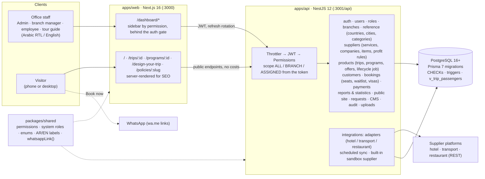

# TakeMeHigh architecture

TakeMeHigh is a modular monolith, sold as **one installation per travel agency** (single-tenant, BR-01). It has four parts:
- a NestJS REST API,
- a Next.js web app (the office dashboard and the office's public page),
- PostgreSQL through Prisma,
- a shared TypeScript package with the permission catalogue and the domain vocabulary.

Requirement ids such as `TRP-05` refer to the SRS in [`docs/srs/takemehigh`](../srs/takemehigh).

## System overview



## Main decisions

| Decision | Why |
|---|---|
| **Single-tenant.** There is no office table and no tenant column. | Each client runs its own copy (BR-01). Isolation is between **branches**: a `branch_id` on users, bookings, payments and customers, enforced in every query (AUTH-08). |
| **Scopes come from the role:** ALL (Admin), BRANCH (manager, employee), ASSIGNED (tour guide). | One rule set covers all four roles. Records outside a user's scope answer **404**, not 403, so their ids cannot be probed. |
| **Permissions are data.** The `permissions` catalogue and `role_permissions` live in the database, seeded from `packages/shared`. | The Admin can edit the three non-Admin roles and add roles without a deployment (AUTH-06). The API checks every route; the UI only hides buttons. |
| **A trip is a sequence of priced service lines.** | Each line stores a snapshot of its cost (`unitCost × quantity`), its profit and its selling price. The trip price is the sum of its lines; a program's price is the sum of its trips (BR-06, BR-07). A booking freezes its own price (PRC-09). |
| **Route rules are pure functions** (`products/rules.ts`). | Place and time continuity (TRP-05), at least two services (BR-04), program chaining (PGM-02) and the best-discount rule (OFR-03) are unit-tested without a database. |
| **Seats are taken with one conditional `UPDATE`.** | `confirmed_seats + n <= max` runs on the trip, the program and every leg inside one transaction, so seats never oversell. A test runs 12 simultaneous confirmations on 5 seats. |
| **A booking targets exactly one of trip / program / offer.** | Three foreign keys plus a `CHECK num_nonnulls(...) = 1`. This keeps referential integrity, unlike a polymorphic `type + id` pair (BKG-02). |
| **Customers link to bookings through `booking_passengers`.** | This is the junction table ("جدول كسر") between customers and bookings. The payer may differ from the travellers. A trip's passengers include those booked through programs, via the `v_trip_passengers` view (BKG-10). |
| **Money and history are append-only.** | Payments, audit entries and booking events reject `UPDATE` and `DELETE` through database triggers. Refunds are new rows linked to the original payment (PAY-05, AUD-02). |
| **Supplier integrations go through adapters** (`integrations/adapters.ts`). | A new supplier only needs a new adapter. Credentials are encrypted with AES-256-GCM and are never returned. When a sync fails, the last known costs stay and get flagged as stale. A cost change flags the open trips that use it (INT-01..07). |
| **Excel exports come from the server; PDFs come from the browser's print view.** | Every list accepts `export=xlsx` (an RTL sheet with the office header) or `export=all`, which feeds the PDF print view. Printing in the browser keeps Arabic shaping correct (RPT-01, RPT-02). |
| **Jobs run in the API** (`@nestjs/schedule`). | Registration closes at the deadline and records the passenger total (CLS-02). Finished trips become COMPLETED. Due supplier syncs run with back-off. Reads also trigger the deadline check, so a list never shows an expired registration as open. |

## Request lifecycle

1. `ThrottlerGuard`: per-route limits. Sign-in is limited to 10 per minute, the public request form to 5 per hour.
2. `JwtAuthGuard`: every route needs a valid 15-minute access token unless it is marked `@Public()`.
3. `PermissionsGuard`: checks `@RequirePermissions` / `@RequireAnyPermission`. A user who still has the initial password can only reach `@AllowWithInitialPassword()` routes (AUTH-10).
4. `ValidationPipe`: `whitelist` and `forbidNonWhitelisted`, so unknown fields are rejected.
5. Services apply the scope (`common/scope.ts`) and the business rules. The SQL constraints catch anything that slips through.
6. `AllExceptionsFilter`: one error shape, `{ statusCode, error, message, path, timestamp }`. SQL details never leak.

## Folders

```
apps/api/src
  auth/  users/  roles/  branches/  reference/  suppliers/  integrations/
  products/   (trips, programs, offers, lifecycle job, pure rules + tests)
  customers/  bookings/ (bookings, seats, payments, visas)
  reports/    public-site/ (public API, requests, CMS)  audit-logs/  uploads/
  common/     (scope, guards, decorators, pagination, Excel export, money, codes, crypto)
apps/web/src
  app/        routes (dashboard, public site, login, change-password)
  components/ data/ (ResourceTable, print, confirm) ui/ (design system) app-shell/
              admin/ suppliers/ trips/ programs/ offers/ customers/ bookings/ payments/
              visas/ requests/ home/ reports/ site/ landing/
packages/shared  permissions, roles, enums, labels
```
