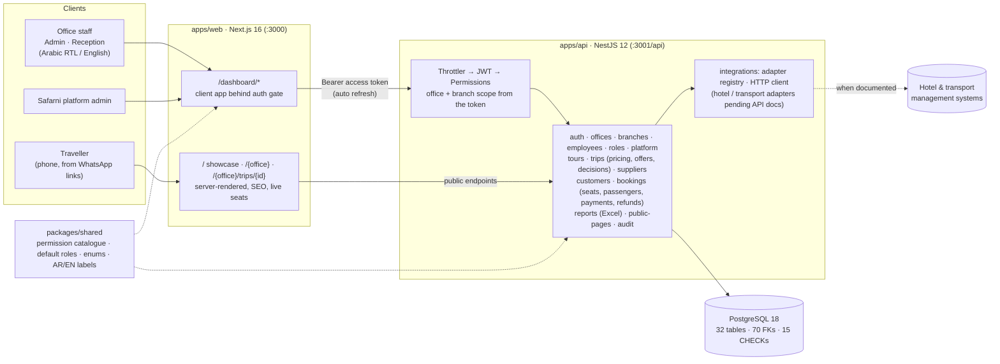

# Safarni architecture

Safarni is a **multi-tenant modular monolith**. It has:
- a NestJS REST API,
- a Next.js web app (the office dashboard plus public pages),
- PostgreSQL through Prisma,
- a shared TypeScript package for permissions and domain vocabulary.

## System overview



## Request lifecycle: confirming a booking

```mermaid
sequenceDiagram
  autonumber
  participant UI as Dashboard (Reception, Damascus)
  participant G as Guards
  participant S as BookingsService
  participant DB as PostgreSQL
  UI->>G: POST /api/bookings/{id}/confirm (Bearer)
  G->>G: JWT valid · permission bookings.confirm · office/branch from token
  G->>S: confirm(user, id)
  S->>DB: BEGIN; SELECT … FROM bookings WHERE id AND office_id FOR UPDATE
  S->>S: booking in user's branch? status PENDING/WAITING_LIST?
  S->>DB: UPDATE trips SET confirmed_seats = confirmed_seats + n<br/>WHERE id AND office_id AND status IN (OPEN, …) AND confirmed_seats + n <= max_seats
  alt 0 rows updated
    S-->>UI: 409 "Only 2 seats left on this trip; this booking needs 3."
  else seats taken
    S->>DB: booking → CONFIRMED · booking_event · audit_log · COMMIT
    S-->>UI: 200 booking
  end
```

## Key decisions

| Decision | Why |
|---|---|
| **Modular monolith** (one NestJS app, a folder per module) | One deployable and one transaction boundary. Clear module seams allow extraction later. |
| **Office = tenant, branch = unit inside it** | Office scoping always applies; branch scoping depends on the role's `scope` (`OFFICE` = Admin sees all branches, `BRANCH` = Reception sees its own). Out-of-scope ids answer **404**, never 403, so they can't be probed. |
| **Composite foreign keys `(office_id, id)`** | The database itself prevents cross-office links. |
| **Configurable roles over a permission catalogue** | The brief asks for a configurable matrix. The owner wants two roles; both are defaults and offices can add more. |
| **Tokens:** 15-min access JWT + opaque rotating refresh token | Refresh tokens are stored as SHA-256 hashes. Reusing an old one revokes the whole session family. Permission changes apply at the next refresh. |
| **Seats:** one conditional `UPDATE`, plus a CHECK constraint | Correct under concurrency without long locks. Tested: 25 parallel confirmations on 10 seats give exactly 10. |
| **Prices computed only on the server; snapshots on bookings** | "Historical booking prices must not change." Totals shown before saving are labelled estimates. |
| **Money:** `NUMERIC(14,2)` + decimal.js, grouped per currency | No floating point. SYP and USD are never summed. |
| **Registration closes lazily** | Trips past their deadline move to `REGISTRATION_CLOSED` on the next read or booking, so no scheduler is needed for the MVP. |
| **i18n:** cookie-driven locale read on the server | The correct `lang`/`dir` on first paint. Each module owns its own AR/EN messages. |
| **PDF from print views, Excel from the API** | Server PDF libraries don't shape Arabic correctly; browsers do. ExcelJS produces RTL sheets. |
| **External suppliers behind an adapter registry** | No invented endpoints. Honest `NOT_CONFIGURED` states until the real APIs are documented. |

## Security controls

- **Authentication:** bcrypt (cost 12), and a timing-safe login for unknown emails. Rate limits: 10/min on login, 30/min on refresh, 300/min globally, 120/min on public pages.
- **Authorization:** a global JWT guard plus a permission guard. Platform-admin routes are separate. Office and branch scope come from the token only, and forged ids in request bodies are rejected (whitelisted DTOs).
- **Data protection:**
  - public endpoints never return costs, profit, supplier names or internal ids
  - supplier secrets are referenced by name only
  - integration logs keep metadata only, never bodies, tokens or passenger data
- **Infrastructure:** Helmet headers, CORS limited to the web origin, one error shape with no SQL or stack traces.
- **Audit:** sensitive actions (prices, decisions, payments, refunds, staff and roles) write `audit_logs` in the same transaction.
- **Known trade-off:** the web app keeps tokens in `localStorage` (hackathon scope). Production should move the refresh token to an httpOnly SameSite cookie.

## Testing

`npm run test:e2e` runs 40 tests: the real NestJS app against the real PostgreSQL database. They cover:
- authentication and refresh-token rotation
- office and branch isolation
- the permission matrix
- pricing (the coach example)
- booking totals with offers
- **concurrent confirmations**
- the waiting list and cancellation
- passenger-count rules and price snapshots
- payment currency and balance limits
- refund limits per payment
- transfers (currency and branch)
- registration decisions
- reports (money per currency, Excel)
- public pages (no internal data leaks; WhatsApp link)
- integration settings (no secrets; honest health check)
