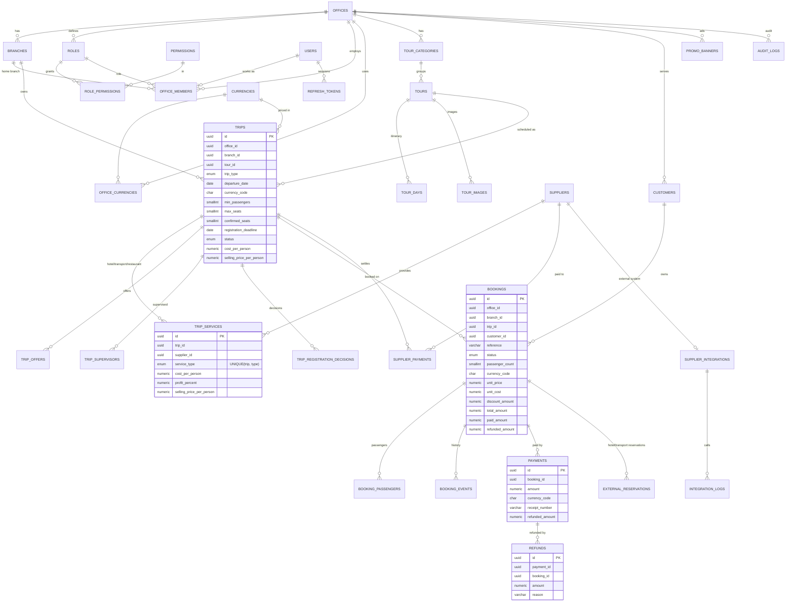

# Safarni database

- **Engine:** PostgreSQL 18, through Prisma 7 (`@prisma/adapter-pg`). Schema: `apps/api/prisma/schema.prisma`.
- **Size:** 32 tables, 70 foreign keys, 15 CHECK constraints. UUID primary keys.
- **Types:** money is `NUMERIC(14,2)`; timestamps are `timestamptz(3)`; calendar dates are `date`.

## Commands

| Command | Effect |
|---|---|
| `npm run db:migrate` | `prisma migrate deploy`: apply pending migrations |
| `npm run db:migrate:dev` | `prisma migrate dev`: create a new migration from schema changes (development) |
| `npm run db:seed` | Load the demo data (refuses if it already exists) |
| `npm run db:reset` | Drop, re-migrate and seed (development only; Prisma asks for confirmation) |
| `npm run db:studio` | Browse the data |

## Isolation built into the schema

- **Every business table carries `office_id`.**
- **Branch-owned tables also carry `branch_id`:** trips, bookings, payments.
- **Composite keys:** parents expose `UNIQUE (office_id, id)` and children reference `(office_id, parent_id)`. For example, a booking references `(office_id, trip_id)` and `(office_id, customer_id)`. So a row can never point to another office's trip, customer, branch, supplier or payment, even through a coding mistake.
- **The application layer adds** office and branch scoping from the verified token on every query (`apps/api/src/common/scope.ts`).

## Entity relationship diagram (core)

## Tables

| Area | Tables |
|---|---|
| Identity & organisation | `users`, `offices`, `branches`, `office_members` (one per user; exactly one branch), `roles`, `permissions`, `role_permissions`, `refresh_tokens` (SHA-256 hash, rotation family) |
| Currencies | `currencies` (SYP, USD), `office_currencies` |
| Programs | `tour_categories`, `tours`, `tour_days`, `tour_images` |
| Trips | `trips`, `trip_services`, `trip_offers`, `trip_supervisors`, `trip_registration_decisions` |
| Suppliers | `suppliers` (HOTEL, TRANSPORT, RESTAURANT), `supplier_payments` |
| Customers & bookings | `customers` (unique phone per office), `bookings`, `booking_passengers`, `booking_events` |
| Money | `payments` (cash, unique receipt per office), `refunds` |
| Integrations | `supplier_integrations` (secret **name** only), `external_reservations`, `integration_logs` |
| Marketing & audit | `promo_banners`, `audit_logs` |

## Business rules enforced by PostgreSQL (CHECK constraints)

| Constraint | Rule |
|---|---|
| `chk_trips_seats` | `0 ≤ confirmed_seats ≤ max_seats`: no overbooking even if code fails |
| `chk_trips_capacity` | `max_seats > 0`, `1 ≤ min_passengers ≤ max_seats` |
| `chk_trips_dates` | return ≥ departure, registration deadline ≤ departure |
| `chk_trips_prices` | non-negative cost and selling price |
| `chk_trip_services_pricing` | `selling ≥ cost`, profit between 0 and 1000 % |
| `chk_trip_offers_value` / `_period` | discount > 0, percentage ≤ 100, end ≥ start |
| `chk_bookings_passengers` | at least one passenger |
| `chk_bookings_amounts` | discount ≤ subtotal, no negative totals, paid or refunded amounts |
| `chk_payments_amount` | amount > 0 and `refunded_amount ≤ amount` |
| `chk_refunds_amount`, `chk_supplier_payments_amount` | amount > 0 |
| `chk_tours_duration` | days ≥ 1, nights ≤ days |
| `chk_promo_banners_period` | end ≥ start |
| `chk_external_reservations` | quantity > 0 |

## Derived values and how they stay consistent

| Value | Source of truth | Kept consistent by |
|---|---|---|
| `trips.confirmed_seats` | Σ passengers of CONFIRMED bookings | Changed only by one conditional `UPDATE … WHERE confirmed_seats + n <= max_seats` inside the booking transaction, plus a CHECK constraint |
| `trips.cost_per_person` / `selling_price_per_person` | Σ of `trip_services` | Recomputed in the same transaction whenever services change |
| `bookings.paid_amount` / `refunded_amount` | payments − refunds | Conditional `UPDATE` in the same transaction as each payment or refund |
| `payments.refunded_amount` | Σ refunds of that payment | Conditional `UPDATE … WHERE refunded_amount + x <= amount` |
| Booking prices | Snapshot at booking time | Never recomputed when trip prices change. Transfers record the old snapshot in `booking_events`. |

## Delete behaviour

- **Office → everything:** CASCADE.
- **Business history is protected:**
  - trips, customers, suppliers and payments referenced by bookings cannot be deleted (the API answers 409 with a hint, e.g. "deactivate instead")
  - payments are never deleted when a booking is cancelled
- **Users referenced in history** (recorded by, decided by) keep their rows. Employees are deactivated, not deleted.
