# TravelOS database

- **Engine:** MariaDB 10.4 (the XAMPP default) or MySQL 8.
- **Character set:** utf8mb4.
- **Time zone:** UTC.
- **Schema size:** 17 tables, **32 foreign keys** and **9 CHECK constraints**, created only through TypeORM migrations in `apps/api/src/database/migrations`.

## Commands

| Command | Effect |
|---|---|
| `npm run db:create` | Creates the `travelos` database if missing |
| `npm run db:migrate` | Runs pending migrations |
| `npm run db:revert` | Reverts the last migration |
| `npm run db:seed` | Seeds the demo agency (refuses if it already exists) |
| `npm run db:reset` | Wipes all data and seeds again (local demo only) |
| `npm run db:setup` | create + migrate + seed |

Migrations so far:
1. `InitialSchema`: all tables, foreign keys, indexes and the business CHECK constraints.
2. `AddTripOffers`: offer price, label and end date on trips, plus `chk_trips_offer`.

## Entity relationship diagram

Every table except `agencies`, `hotel_details` and `transportation_details` has an `agency_id` foreign key to `agencies`. The diagram leaves those tenant links out so it stays readable.

```mermaid
erDiagram
  AGENCIES ||--|| AGENCY_SETTINGS : "has"
  AGENCIES ||--o{ USERS : "employs"
  AGENCIES ||--o{ CUSTOMERS : "serves"
  AGENCIES ||--o{ DESTINATIONS : "offers"
  AGENCIES ||--o{ SUPPLIERS : "works with"
  AGENCIES ||--o{ TRIPS : "runs"
  DESTINATIONS ||--o{ TRIPS : "hosts"
  TRIPS ||--o{ TRIP_ITINERARIES : "day by day"
  TRIPS ||--o{ TRIP_SUPPLIERS : "uses services"
  SUPPLIERS ||--o{ TRIP_SUPPLIERS : "provides"
  SUPPLIERS ||--o| HOTEL_DETAILS : "if hotel"
  SUPPLIERS ||--o| TRANSPORTATION_DETAILS : "if transport"
  TRIPS ||--o{ BOOKINGS : "sold as"
  CUSTOMERS ||--o{ BOOKINGS : "makes"
  USERS ||--o{ BOOKINGS : "created by"
  BOOKINGS ||--o{ BOOKING_PASSENGERS : "travellers"
  BOOKINGS ||--o{ PAYMENTS : "paid by"
  BOOKINGS ||--o{ REFUNDS : "refunded by"
  USERS ||--o{ PAYMENTS : "received by"
  USERS ||--o{ REFUNDS : "processed by"
  TRIPS ||--o{ EXPENSES : "costs"
  SUPPLIERS ||--o{ EXPENSES : "billed by"
  USERS ||--o{ ACTIVITY_LOGS : "performed"

  AGENCIES { varchar id PK  varchar slug UK  varchar name  char currency  varchar timezone  bool is_active }
  AGENCY_SETTINGS { varchar agency_id FK,UK  bool public_page_enabled  decimal deposit_percent  smallint balance_due_days_before_departure  varchar brand_color }
  USERS { varchar id PK  varchar agency_id FK  varchar email UK  varchar password_hash  enum role  bool is_active }
  CUSTOMERS { varchar id PK  varchar agency_id FK  varchar first_name  varchar last_name  varchar email  varchar phone  varchar passport_number }
  DESTINATIONS { varchar id PK  varchar agency_id FK  varchar name  varchar country }
  TRIPS { varchar id PK  varchar agency_id FK  varchar code  varchar destination_id FK  date departure_date  date return_date  int capacity  int seats_booked  decimal price_per_person  decimal child_price  decimal offer_price  date offer_ends_at  enum status  bool is_public }
  TRIP_ITINERARIES { varchar id PK  varchar trip_id FK  smallint day_number  varchar title }
  SUPPLIERS { varchar id PK  varchar agency_id FK  enum type  varchar name  tinyint rating  bool is_active }
  HOTEL_DETAILS { varchar id PK  varchar supplier_id FK,UK  tinyint star_rating  decimal nightly_rate }
  TRANSPORTATION_DETAILS { varchar id PK  varchar supplier_id FK,UK  enum vehicle_type  int fleet_size  decimal daily_rate }
  TRIP_SUPPLIERS { varchar id PK  varchar trip_id FK  varchar supplier_id FK  varchar service  int quantity  decimal unit_cost  decimal total_cost }
  BOOKINGS { varchar id PK  varchar agency_id FK  varchar reference  varchar trip_id FK  varchar customer_id FK  enum status  enum source  smallint seats  decimal total_amount  decimal paid_amount  decimal refunded_amount  enum payment_status }
  BOOKING_PASSENGERS { varchar id PK  varchar booking_id FK  varchar full_name  enum type }
  PAYMENTS { varchar id PK  varchar booking_id FK  decimal amount  enum method  bool is_deposit  datetime paid_at }
  REFUNDS { varchar id PK  varchar booking_id FK  decimal amount  enum method  varchar reason  datetime refunded_at }
  EXPENSES { varchar id PK  varchar agency_id FK  enum category  decimal amount  date expense_date  varchar trip_id FK  varchar supplier_id FK }
  ACTIVITY_LOGS { varchar id PK  varchar agency_id FK  varchar user_id FK  varchar action  varchar entity_type  varchar summary  json metadata }
```

## Tables

| Table | Purpose | Notable rules |
|---|---|---|
| `agencies` | Tenant: one travel agency | `slug` unique (public page URL) |
| `agency_settings` | Public page, deposit %, balance due days, terms, brand colour | 1:1 with agency |
| `users` | Staff accounts with one of 5 roles | `email` unique platform-wide; bcrypt hash never selected by default |
| `customers` | Traveller records | Indexed by (agency, name), (agency, phone), (agency, email); duplicates are blocked in the service |
| `destinations` | Places the agency sells | Unique (agency, name) |
| `trips` | Programs with dates, capacity, prices and offers | Unique (agency, code). `seats_booked` is maintained atomically. CHECKs: seats ≤ capacity, capacity > 0, return ≥ departure, offer < price |
| `trip_itineraries` | Day-by-day plan | Unique (trip, day_number) |
| `suppliers` | Hotels, transport, guides, other | Type-specific details in two 1:1 tables |
| `hotel_details` / `transportation_details` | Stars, rooms, nightly rate / vehicle type, fleet, daily rate | Unique supplier_id |
| `trip_suppliers` | Services a supplier provides for a trip, with cost | Feeds the projected margin |
| `bookings` | Reservations | Unique (agency, reference). CHECKs: adults ≥ 1, seats = adults + children, non-negative amounts. Indexed by (agency, status, created_at), (trip, status), payment status |
| `booking_passengers` | Named travellers per booking | Count equals seats |
| `payments` / `refunds` | Money in and out per booking | CHECK amount > 0. `bookings.paid_amount` is updated in the same transaction |
| `expenses` | Agency costs, optionally per trip or supplier | CHECK amount > 0 |
| `activity_logs` | Append-only audit trail | Written in the same transaction as the change |

## Delete behaviour

| Relationship | On delete |
|---|---|
| Agency → all tenant rows | CASCADE |
| Trip → itinerary / trip_suppliers | CASCADE |
| Booking → passengers | CASCADE |
| Trip, customer, destination, supplier referenced by bookings or services | RESTRICT. The API answers 409 with a hint, for example "set status to Cancelled instead". |
| User referenced as creator, receiver or processor | SET NULL (history is kept) |
