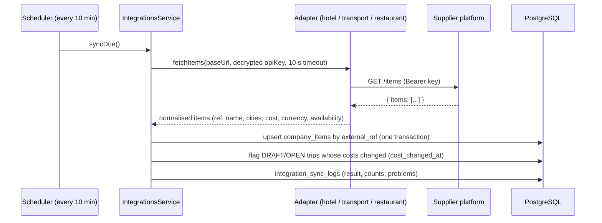

# Supplier integrations

The office works with a hotel platform, a transport platform (land, sea or air) and a restaurant platform. Each one supplies the **cost per person** of its services. The office then adds its own profit (BR-07). The integration rules are INT-01 to INT-10 in the SRS.

## How it works



- **Adapters** (`apps/api/src/integrations/adapters.ts`): every supplier is reached through the `SupplierAdapter` interface (`health`, `fetchItems`). Adding a supplier means adding one adapter (INT-01).
- **Credentials:** the API key is encrypted with AES-256-GCM. The key comes from `CREDENTIALS_KEY`, or from `JWT_SECRET` when that is empty. The API never returns the credentials; the UI only shows "key saved" (INT-03).
- **Schedule:** each connection syncs every `sync_interval_hours`, 6 by default. The Admin can also press "Sync now" (INT-04). Every run is logged (INT-05).
- **Failures:**
  - A failed sync keeps the last known costs (INT-06).
  - Items that have not synced for 24 hours get the `is_stale` flag.
  - Retries back off: 5, 10, 20, 40 minutes and so on.
  - Building a trip is never blocked.
- **Snapshots:** a cost change never touches existing trips or bookings. Open trips that use the changed item get the `COST_CHANGED` warning. The Admin then presses **Accept current costs** to reprice them (INT-07).
- **Manual fallback:** companies and items can always be entered by hand (INT-08).
- **Read-only costs:** the cost of an integration item cannot be edited (SUP-06).

## Generic REST contract v1

The suppliers' own documentation has not arrived yet (TBD-02). Until it does, the three adapters speak this contract. A supplier that follows it works with no code change.

```
GET {baseUrl}/health   → 200 OK
GET {baseUrl}/items    → 200 { "items": [
  { "id": "T-DAM-LTK-BUS",            // stable reference
    "name": "دمشق ← اللاذقية — بولمان VIP",
    "description": "…",                // optional
    "from": "Damascus",                // transport: departure city (English or Arabic name)
    "to": "Latakia",                   // transport: arrival city; hotel/restaurant: its city
    "price_per_person": "200000.00",   // decimal string, up to 2 decimals
    "currency": "SYP",                 // ISO 4217, must exist in the currencies table
    "available": true,                 // optional
    "mode": "LAND" }                   // optional for transport: LAND | SEA | AIR
] }
Authorization: Bearer <api key>
```

An item is reported as a problem and skipped when its city or currency is unknown. It is never invented.

## Sandbox supplier

`/api/sandbox/suppliers/{hotel|transport|restaurant}` implements the contract with realistic Syrian data. A few prices move by up to 3% each day, so a sync shows real cost changes. The demo seed points the three integrated companies at it, using the key `SANDBOX_SUPPLIER_KEY`. Turn it off with `SUPPLIER_SANDBOX=false`.

## Replacing the sandbox with a real supplier

1. When the supplier's documentation arrives, write an adapter class that implements `SupplierAdapter` and register it in `ADAPTERS`.
2. In the dashboard (Suppliers → Integrations), choose the adapter, enter the base URL and the key, then press **Test**.
3. Press **Sync now**, and check the log.
