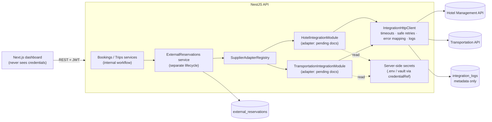

# Supplier integrations: hotel & transportation systems

**Status: foundation only. Waiting for the API documentation and sandbox credentials.**

Safarni must integrate with two existing systems: a **Hotel Management** system and a **Transportation Company Management** system.

The documentation for those APIs has **not been supplied yet**. As the brief requires, no endpoint, parameter, response field or authentication method has been invented. What exists today is the provider-neutral foundation (data model, adapter contract, HTTP layer). Each adapter is written against its real API once the documentation arrives.

---

## 1. API capability analysis

| Capability | Hotel system | Transportation system |
|---|---|---|
| List hotels / rooms, or trips / services | ❓ unknown, needs docs | ❓ unknown, needs docs |
| Room types / routes / schedules | ❓ | ❓ |
| Prices for dates | ❓ | ❓ |
| Availability check before booking | ❓ | ❓ |
| Create reservation | ❓ | ❓ |
| External reference + confirmation | ❓ | ❓ |
| Retrieve reservation (status sync) | ❓ | ❓ |
| Cancel reservation | ❓ | ❓ |
| Idempotency key on writes | ❓ | ❓ |
| Webhooks / callbacks | ❓ | ❓ |
| Authentication method | ❓ | ❓ |
| Rate limits / sandbox | ❓ | ❓ |

Each ❓ becomes ✅ supported or ❌ not supported once the documentation is reviewed. Each adapter then declares this in `IntegrationCapabilities` (`apps/api/src/integrations/integration.types.ts`). Unsupported operations are simply not offered in the UI.

**Restaurants** have no external system. They are managed manually in the MVP.

## 2. Integration architecture



- **One adapter per provider** behind the same `SupplierAdapter` contract. Adding another supplier later only adds a module.
- **The registry is empty today.** Calls return `NOT_CONFIGURED` ("this supplier is managed manually") instead of a fake success.
- **Implemented now:**
  - **Data model:**
    - `supplier_integrations`: connection settings per supplier, with `credentialRef` (the name of a server-side secret, never the secret itself)
    - `external_reservations`
    - `integration_logs`
  - **`IntegrationHttpClient`:**
    - 10 s timeout
    - retries only for reads, with exponential backoff and `Retry-After` support
    - writes are never retried
    - errors are mapped to `TIMEOUT / UNAVAILABLE / RATE_LIMITED / UNAUTHORIZED / REJECTED`
    - one log row per attempt (path, status, duration, error code), with no bodies, no query strings and no personal data

## 3. API endpoint mapping

| Safarni operation | Hotel endpoint | Transportation endpoint |
|---|---|---|
| `healthCheck` | needs docs | needs docs |
| `checkAvailability` | needs docs | needs docs |
| `reserve` | needs docs | needs docs |
| `getReservation` | needs docs | needs docs |
| `cancel` | needs docs | needs docs |

## 4. Data mapping (Safarni side is fixed, provider side pending docs)

| Safarni | Meaning | Hotel field | Transport field |
|---|---|---|---|
| `supplier_integrations.external_supplier_id` | Hotel / operator id in their system | ? | ? |
| `AvailabilityQuery.externalServiceId` | Room type / route / service code | ? | ? |
| `from`, `to` | Trip departure and return dates | check-in / check-out ? | departure date ? |
| `quantity` | Rooms or seats (from confirmed passengers) | rooms ? | seats ? |
| `ExternalOutcome.externalReference` | Their booking number | ? | ? |
| `trip_services.cost_per_person` | Our net cost; may be refreshed from their prices | rate ? | fare ? |

Booking prices are **snapshots**. A later supplier price change never changes existing bookings.

## 5. Booking & cancellation workflows

The **internal booking and the external reservations are separate**:
- An internal booking can be `CONFIRMED` (seats taken in Safarni) while its hotel reservation is still `PENDING` or `FAILED`.
- The employee always sees both statuses.

```mermaid
sequenceDiagram
  autonumber
  actor E as Employee
  participant S as Safarni API
  participant H as Hotel API
  participant T as Transport API
  E->>S: Confirm booking (internal; seats reserved atomically)
  E->>S: Request external reservations
  S->>S: Create external_reservations rows (one per service, unique per booking+service, idempotency key)
  par Hotel
    S->>H: reserve(idempotencyKey)
    H-->>S: confirmed (ref H-123)
    S->>S: hotel → CONFIRMED, store ref
  and Transport
    S->>T: reserve(idempotencyKey)
    T--xS: timeout
    S->>S: transport → UNKNOWN (never blind-retry)
  end
  S-->>E: Hotel ✅ confirmed · Transport ⚠️ needs reconciliation
  E->>S: Reconcile transport
  S->>T: getReservation / lookup by idempotency key (if supported)
  T-->>S: found ref T-77 / not found
  S->>S: transport → CONFIRMED or FAILED (then a safe retry is allowed)
```

The rules:
- **Partial success is recorded as is.** A confirmed hotel stays confirmed when the transport fails. Nothing is cancelled automatically: compensation needs an explicitly approved workflow (open decision 4).
- **Duplicate prevention:**
  - `UNIQUE(booking_id, trip_service_id)` allows one external reservation per service per booking.
  - A unique `idempotency_key` is sent to the provider when it supports one.
  - `PENDING`, `CONFIRMED` and `UNKNOWN` block new attempts.
- **Uncertain outcomes:** a timeout after sending a write becomes `UNKNOWN` and goes to reconciliation. It is never retried blindly.
- **Cancellation:** an internal cancellation releases seats immediately. The external cancellation is a separate step: `CANCELLATION_PENDING` → `CANCELLED` / `CANCELLATION_FAILED`, shown to the employee.
- **Status sync:** `lastSyncedAt` plus `getReservation` (polling, or webhooks if the provider has them).

## 6. Error-handling strategy

| Error | Mapping | Behaviour |
|---|---|---|
| Network error / 10 s timeout on a **read** | `TIMEOUT` / `UNAVAILABLE` | Up to 3 attempts with backoff, then "External system unavailable" |
| Timeout on a **write** | `TIMEOUT` | No retry. Reservation goes to `UNKNOWN` → reconcile |
| 429 | `RATE_LIMITED` | Honour `Retry-After` (capped at 30 s). Reads only |
| 5xx | `UNAVAILABLE` | Retry reads, never writes |
| 401 / 403 | `UNAUTHORIZED` | Integration status becomes `ERROR`, no retry, admin notified in the UI |
| Other 4xx | `REJECTED` | Reservation `FAILED` with the provider's reason (sanitised) |
| Unexpected body | `BAD_RESPONSE` | `FAILED`, logged without the body |

## 7. Security requirements

- **Credentials never leave the backend.**
  - The database stores only `credentialRef` (the name of the secret).
  - Secrets live in server env or a vault.
  - Responses never include them, and the UI shows only "configured / not configured" plus health.
- **Logs** keep the operation, path (no query string), status, duration, error code and correlation id. They never keep bodies, tokens, passwords or passenger data.
- **Tenant isolation:**
  - Every integration, external reservation and log row carries `office_id`, with composite foreign keys `(office_id, id)`.
  - An office can't read, use or configure another office's integration.
  - **Configuration** needs `suppliers.manage` (Admin). **Requesting reservations** needs `bookings.confirm`, and the reservation stays inside the user's branch scope.
- Passenger data is sent to a provider only when its API requires it, and only the fields it requires.
- HTTPS is required for provider base URLs outside local development.

## 8. Required changes to the SRS

Add these to `docs/srs/SRS.md` once the APIs are known:
- **FR-INT-1:** connect a hotel or transport supplier to its external system (Admin only), with a health check.
- **FR-INT-2:** check availability and prices from the provider before booking, where supported.
- **FR-INT-3:** create, retrieve and cancel external reservations per booking service, with their own statuses.
- **FR-INT-4:** handle partial success, uncertain outcomes (reconciliation) and duplicate prevention.
- **NFR-INT-1..3:** timeouts and retries, credential handling, metadata-only integration logs.

## 9. Missing information and open questions

**Needed from the supplier systems (blocking the adapters):**
1. API documentation for the **Hotel Management** system: endpoints, request and response schemas, error format.
2. API documentation for the **Transportation** system: same as above.
3. **Authentication method** for each (API key, OAuth2 client credentials, JWT…) and how keys are issued **per office**.
4. **Sandbox / test environment** URLs and **test credentials**. Production secrets must never be shared in chat or committed.
5. Rate limits, timeouts, and whether **idempotency keys** and **webhooks** are supported.
6. How offices are identified in each system: one account per tourism office, or a shared platform account?

**Business decisions:**
1. When are external reservations made: on internal confirmation, manually by the employee, or when the trip is approved after the registration deadline?
2. Per passenger or per group? (One room per couple? Block-booking a whole coach?)
3. What happens to the internal booking when an external reservation fails: stay confirmed with a warning, or move back to pending?
4. Is there an approved **compensation** workflow (for example, cancel the hotel automatically if the transport fails)? The default is no automatic compensation.
5. Does the supplier price from the API override the manually entered `cost_per_person`, and does that need approval?
6. Who pays the provider, and how: through the office's supplier payments, or settled in their system?
