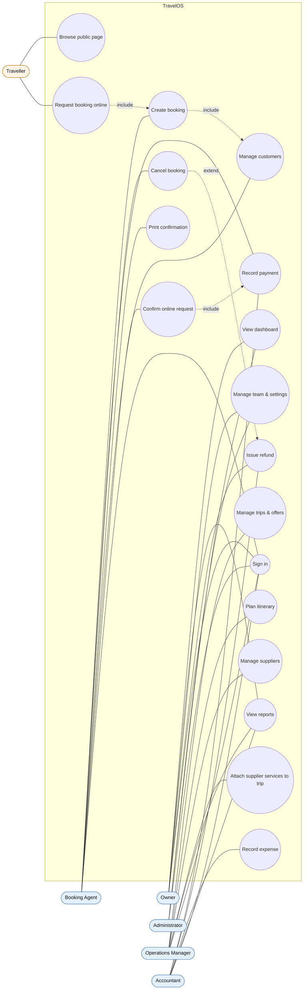

# TravelOS use cases

## Actors

| Actor | Description | Main goals |
|---|---|---|
| **Owner** | Runs the agency; full access | Watch performance, manage team and settings, approve refunds |
| **Administrator** | Office manager with full operational access (cannot create owners) | Configure agency, manage staff, oversee operations |
| **Operations Manager** | Plans programs and works with suppliers | Create trips and offers, itineraries, link hotels and transport |
| **Booking Agent** | Front desk, phone or WhatsApp | Find trips with seats, book customers, take payments |
| **Accountant** | Finance | Record payments, refunds, expenses; read reports |
| **Traveller** (external) | Member of the public using the agency's public page | See published trips and offers, request a booking |
| **System** (secondary) | TravelOS itself | Enforce seats, prices, permissions, tenant isolation, audit trail |

## Use case diagram

The source is in PlantUML: [`../diagrams/use-cases.puml`](../diagrams/use-cases.puml). The Mermaid rendering is below.

The Owner and Administrator can also perform every staff use case. The diagram shows only their distinctive ones.

---

## UC-01 Sign in
- **Actors:** all staff
- **Preconditions:** the user account is active, and so is its agency.
- **Main flow:**
  1. The user enters email and password.
  2. The system verifies the bcrypt hash and issues an 8-hour JWT carrying the user, agency and role.
  3. The system shows the dashboard, with navigation filtered by role.
- **Alternative flows:**
  - **A1. Wrong credentials or inactive account:** a generic "Invalid email or password" (no hint which part was wrong).
  - **A2. More than 10 attempts per minute:** 429, try again later.
- **Postconditions:** the session is active, and `last_login_at` is updated.

## UC-03 Manage trips & offers
- **Actor:** Operations Manager (also Owner and Admin)
- **Preconditions:** signed in with `trips.write`.
- **Main flow:**
  1. The user creates a trip: code, title, destination, dates, capacity, adult and child prices, cost per person.
  2. Optionally the user adds an offer: offer price, label, end date.
  3. The user sets the status to Published and switches on "show on public page".
  4. The system validates, saves and logs `trip.created`.
- **Alternative flows:**
  - **A1. Return date before departure:** 400 with a message.
  - **A2. Offer price not below the normal price:** 400 (also guarded by `chk_trips_offer`).
  - **A3. Capacity lowered below seats already booked:** 409 "Capacity cannot be lower than the N seats already booked".
  - **A4. Delete a trip with bookings:** 409, suggesting Cancelled status instead.
- **Postconditions:**
  - The trip is bookable (when Published) and visible on the public page (when public).
  - The active offer is applied to new bookings automatically.

## UC-07 Create booking ⭐
- **Actor:** Booking Agent (also Owner, Admin and Ops)
- **Preconditions:** signed in with `bookings.write`; the trip is Published and departs in the future.
- **Main flow:**
  1. The agent picks a trip, which shows seats left and the current price, including any offer.
  2. The agent selects an existing customer or enters a new one. The system reuses a customer with the same email or phone.
  3. The agent enters adults, children, an optional discount, passengers and notes.
  4. Optionally the agent records a payment now (deposit or full).
  5. The system, in **one transaction**:
     - reserves the seats with a conditional update,
     - computes prices from the trip,
     - creates the booking, passengers and payment,
     - writes the activity log.
  6. The system returns the booking with reference `TOS-YY-XXXXXX`.
- **Alternative flows:**
  - **A1. Not enough seats:** 409 "Only 2 seats left on this trip; you requested 3." Nothing is saved.
  - **A2. Trip full:** 409 "This trip is fully booked."
  - **A3. Discount above subtotal:** 400.
  - **A4. The trip belongs to another agency:** 404.
  - **A5. The payment reaches the deposit %:** the booking is created as Confirmed.
- **Postconditions:**
  - `trips.seats_booked` has increased, and the trip becomes FULL when no seats remain.
  - The dashboard and reports reflect the booking immediately.

## UC-08 Record payment
- **Actors:** Booking Agent, Accountant
- **Preconditions:** the booking is not cancelled and has a balance above 0.
- **Main flow:**
  1. The user enters amount, method and reference.
  2. The system locks the booking row, checks amount ≤ balance, inserts the payment and updates `paid_amount` and the payment status.
  3. If the paid amount reaches the agency's deposit % on a Pending booking, the booking becomes **Confirmed**.
- **Alternative flows:**
  - **A1. Amount above the balance:** 400 "Payment exceeds the remaining balance of X".
  - **A2. Payment date in the future:** 400.
- **Postconditions:**
  - The payment status is Partial or Paid.
  - The revenue KPIs are updated.

## UC-09 Cancel booking (extends with UC-10 Issue refund)
- **Actors:** Booking Agent (cancel), Accountant or Owner (refund)
- **Preconditions:** the booking is Pending or Confirmed.
- **Main flow:**
  1. The user gives a reason and optionally a refund amount and method.
  2. The system, in one transaction:
     - releases the seats (a FULL trip reopens to Published),
     - marks the booking Cancelled,
     - records the refund (≤ paid),
     - writes the log.
- **Alternative flows:**
  - **A1. Already cancelled or completed:** 409.
  - **A2. Refund above the amount paid:** 400, and the whole cancellation is rolled back.
- **Postconditions:**
  - The seats are available again.
  - The balance is zero, and the payment status is Refunded when money was returned.

## UC-11 Print confirmation
- **Actor:** Booking Agent
- **Main flow:**
  1. The agent opens the confirmation.
  2. The system assembles the agency details, trip, passengers, price breakdown, payments, balance and terms.
  3. The agent prints or saves a PDF.
- **Postconditions:** the customer receives a professional document instead of a WhatsApp message.

## UC-12 Manage customers
- **Actors:** Booking Agent (also Owner, Admin and Ops)
- **Main flow:**
  1. The agent searches by name, phone or email.
  2. The agent opens the profile: bookings, payments, outstanding balance, notes.
  3. The agent edits the details.
- **Alternative flows:**
  - **A1. The email or phone already exists:** 409 naming the existing customer.
  - **A2. Delete a customer with bookings:** 409.
- **Security:** passport numbers are masked for roles without `customers.write`.

## UC-13 Record expense
- **Actor:** Accountant
- **Main flow:**
  1. The accountant enters a category, description, amount and date.
  2. Optionally the accountant links the expense to a trip or supplier.
  3. The system saves it, and it appears in profit and trip profitability.
- **Alternative flows:**
  - **A1. Amount ≤ 0:** 400 (also guarded by `chk_expenses_amount`).

## UC-14 View reports
- **Actors:** Owner, Admin, Ops, Accountant
- **Main flow:**
  1. The user picks a period.
  2. The system shows:
     - revenue, refunds and expenses by month
     - trip profitability (actual or estimated cost)
     - seat utilisation
     - popular trips
     - outstanding balances with due dates and overdue flags
     - booking sources and payment methods
- **Alternative flows:**
  - **A1. Booking Agent:** 403. The menu item is hidden.

## UC-15 Manage team & settings
- **Actors:** Owner, Administrator
- **Main flow:**
  - The user edits the agency profile, deposit %, balance-due days, terms and public page settings.
  - The user adds team members with a role, and changes their roles or deactivates them.
- **Alternative flows:**
  - **A1. An administrator tries to create or modify an owner:** 403.
  - **A2. Deactivating or demoting the last active owner:** 409.
  - **A3. Changing your own role or deactivating yourself:** 400.

## UC-16/17 Browse public page and request booking ⭐
- **Actor:** Traveller (no account)
- **Preconditions:** the agency has enabled its public page.
- **Main flow:**
  1. The traveller opens `/a/{agency}` and sees the agency's branding and its public upcoming trips, with live seats left and offers.
  2. The traveller opens a trip and reads the itinerary, inclusions and price.
  3. The traveller submits name, phone, number of travellers and a message.
  4. The system creates a **Pending** booking (source Public page) that holds the seats, and returns a reference.
- **Alternative flows:**
  - **A1. Page disabled or unknown agency:** 404.
  - **A2. Not enough seats:** 409, and availability is refreshed.
  - **A3. More than 5 requests per minute:** 429.
- **Postconditions:**
  - The request appears instantly in the agency's bookings and dashboard.
  - No internal data (costs, notes, ids) is exposed.

## UC-18 Confirm online request
- **Actor:** Booking Agent
- **Main flow:**
  1. The agent filters bookings by source Public page and status Pending.
  2. The agent calls the traveller.
  3. The agent records the deposit (UC-08), which confirms the booking automatically, or confirms it manually.
- **Alternative flows:**
  - **A1. The traveller doesn't answer:** the agent cancels (UC-09), and the seats return to sale.
