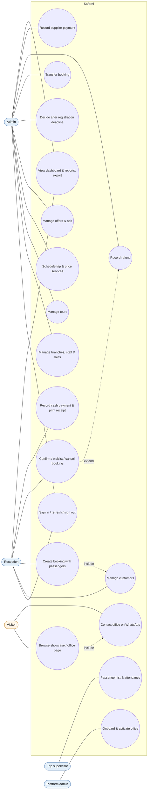

# Safarni use cases

## Actors

| Actor | Description |
|---|---|
| **Admin** (office scope) | Runs the office: all branches, staff, roles, tours, trips, prices, offers, decisions, suppliers, refunds, profit |
| **Reception** (branch scope) | Front desk of one branch: customers, bookings, passengers, cash payments, operational reports |
| **Trip supervisor** (custom role, optional) | Sees assigned trips, the passenger list, records attendance |
| **Platform admin** | Safarni staff: onboards and (de)activates offices |
| **Visitor** (external) | Browses the public showcase and office pages; contacts the office on WhatsApp |
| **System** (secondary) | Enforces seats, prices, scope, currencies; closes registration at the deadline |
| **Hotel / transport system** (external, future) | Receives reservations once integrated |

## Use case diagram

The PlantUML source is in [`../diagrams/use-cases.puml`](../diagrams/use-cases.puml).

The Admin can also do every Reception use case, in all branches.

---

## UC-5 Schedule a trip and price its services
- **Actor:** Admin (`trips.manage`)
- **Preconditions:** an active tour exists; the suppliers are registered.
- **Main flow:**
  1. The admin picks a tour, a branch, VIP or Standard, the dates, a currency, the minimum and maximum seats, and the registration deadline.
  2. The admin adds services: one hotel, one transport and one restaurant at most, each with its net cost per person and a profit %.
  3. The system computes selling = cost × (1 + %) per service, sums them into the trip price, and saves the trip as DRAFT.
  4. The admin opens registration.
- **Alternatives:**
  - **A1. Two suppliers of the same type:** 400.
  - **A2. Opening without priced services:** 400.
  - **A3. Lowering capacity below the confirmed seats:** 409.
- **Postcondition:** the trip is bookable; if public, it appears on the showcase.
- **Example:** coach 200,000 SYP at 15%, hotel 450,000 at 20%, restaurant 150,000 at 25% → **957,500 SYP per person**.

## UC-9 Create a booking with passengers ⭐
- **Actor:** Reception (`bookings.create`), in its own branch
- **Preconditions:** the trip is OPEN and belongs to the employee's branch.
- **Main flow:**
  1. The employee selects the trip.
  2. The employee selects or creates the customer (the contact).
  3. The employee enters every passenger: name, date of birth, nationality, document type and number.
  4. The system computes the total from the trip price and the active offer, and freezes the price snapshot.
  5. Optionally, the employee confirms now (takes seats) and records a first cash payment.
  6. The system returns the booking reference.
- **Alternatives:**
  - **A1. The trip belongs to another branch:** 404.
  - **A2. Confirming on a full trip:** 409, or the booking goes to the waiting list if requested.
  - **A3. The phone already belongs to a customer:** that customer is reused.
- **Postcondition:** a PENDING booking takes no seats; a CONFIRMED one takes them atomically.

## UC-10 Confirm, waitlist or cancel a booking
- **Actor:** Reception
- **Main flow:**
  - **Confirm:** the system locks the booking, takes the seats only if they fit, and records the event.
  - **Waitlist:** PENDING → WAITING_LIST, no seats.
  - **Cancel (with a reason):** a confirmed booking releases its seats; payments are kept.
- **Alternatives:**
  - **A1. Not enough seats:** 409 "Only N seats left…".
  - **A2. Already cancelled:** 409.
- **Extension:** UC-13 refund.

## UC-11 Transfer a booking
- **Actor:** Admin (`bookings.transfer`)
- **Main flow:**
  1. The admin picks an OPEN target trip in the same currency and scope.
  2. The system re-prices the booking at the target's current price and offer.
  3. For a confirmed booking, the system moves the seats: it takes them on the target first, then releases the source.
  4. The system records TRANSFERRED with the old and new prices.
- **Alternatives:**
  - **A1. Different currency:** 409.
  - **A2. The target is full:** 409.
  - **A3. The new total would be below what was already paid:** 409 (refund first).
  - **A4. Active external reservations:** 409 (cancel them first).

## UC-12 Record a cash payment and print the receipt
- **Actor:** Reception (`payments.record`)
- **Main flow:**
  1. The employee enters the amount (in the booking's currency, at most the balance).
  2. The system issues a receipt number and updates the paid amount atomically.
  3. The employee prints the receipt.
- **Alternatives:**
  - **A1. Another currency:** 400.
  - **A2. Above the balance:** 400.
  - **A3. A cancelled booking:** 409.

## UC-13 Record a refund
- **Actor:** Admin (`refunds.record`)
- **Main flow:**
  1. The admin selects the original payment and enters the amount and reason.
  2. The system checks the amount against what remains refundable on that payment.
  3. The system records the refund and updates the payment and the booking.
- **Alternatives:**
  - **A1. Above what remains refundable:** 400.
- **Postcondition:** the original payment stays; refunds are linked to it.

## UC-7 Decide after the registration deadline
- **Actor:** Admin (`trips.decide`)
- **Trigger:** the deadline passes, and the system moves the trip to REGISTRATION_CLOSED.
- **Main flow:** the admin compares confirmed passengers against the minimum, then:
  - **APPROVE:** the trip runs.
  - **EXTEND:** sets a new deadline and reopens registration.
  - **CANCEL:** all bookings are cancelled, seats are released, payments are kept for refunds.
- **Postcondition:** the decision is recorded with the counts at the time it was made.

## UC-14 Record a supplier payment
- **Actor:** Admin (`suppliers.pay`)
- **Main flow:**
  1. The admin selects a trip the supplier serves; the system shows what is due (cost × confirmed passengers), paid and remaining.
  2. The admin records the amount in the trip's currency.
- **Alternatives:**
  - **A1. Above cost × maximum seats:** 400.

## UC-15 Dashboard, reports and export
- **Actors:** Admin (all), Reception (operational, own branch)
- **Main flow:**
  1. The user views the KPIs, upcoming trips and tasks.
  2. The user opens a report (bookings, upcoming trips, passengers, customer statement, payments*, refunds*, trip profit*).
  3. The user exports it to Excel or prints it to PDF.
- **Rules:**
  - Money is shown per currency.
  - Financial reports (*) need `reports.financial`.

## UC-17 / UC-18 Browse public pages and contact the office ⭐
- **Actor:** Visitor (no account)
- **Main flow:**
  1. The visitor opens the showcase and sees the moving ads.
  2. The visitor filters by destination, category, date, VIP or Standard, or offers.
  3. The visitor opens a trip: itinerary, price and offer, seats left, and the office with its location.
  4. The visitor taps "Book on WhatsApp"; WhatsApp opens to the office with a prefilled message containing the trip.
- **Alternatives:**
  - **A1. The office disabled its page:** 404, and its trips leave the showcase.
- **Postcondition:** no booking record is created; the office books the traveller internally (UC-9).
